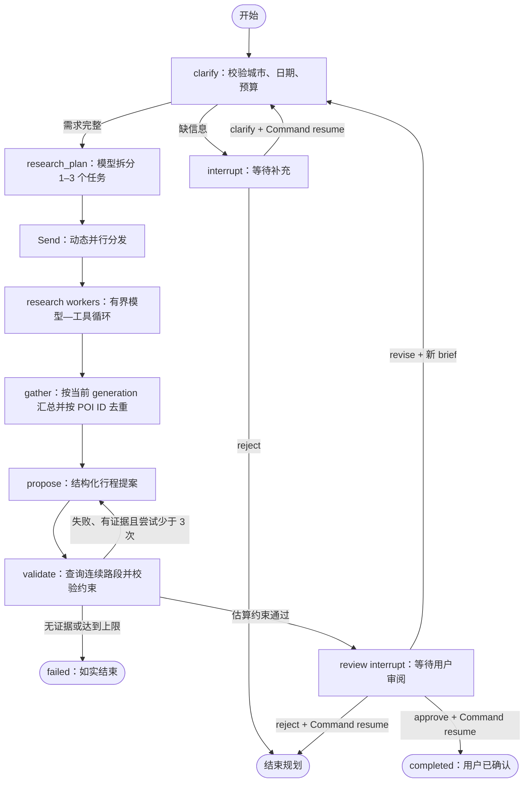

# RouteAI v3：可恢复、可检查的旅行 Agent

核对日期：2026-10-26。本文以 `backend/app/agents/v3/`、`backend/app/api/routes/agent.py`、独立入口 `backend/app/api/agent_app.py` 和 `backend/requirements-agent.lock.txt` 为准。旧图仍保留供经典版兼容，不能把旧版、新版和计划中的能力混写成同一条已上线链路。

本轮重构的结果是一个受约束的同城一日规划流程：模型拆分检索任务，多个研究 worker 自主调用只读工具取得 POI，规划模型引用证据生成提案，代码检查约束，并在用户确认前持久暂停。它体现的是 **Agent 的自主决策与确定性工作流如何配合**，并不追求无限自治或更多 Agent 名称。

## 1. 原有缺口与本轮改变

| 原有实现中可定位的事实 | 对使用和简历表述的影响 | v3 的实际改变 |
| --- | --- | --- |
| `agents/graph.py` 使用 `MemorySaver` | 同一进程内可保留状态，进程退出后不能据此宣称恢复 | `AsyncSqliteSaver` 保存 checkpoint，独立 runtime 启动时检查未完成任务 |
| `human_review_node` 设置 `NEED_CONFIRM` 后返回，图的下一条边是 `END` | “等待审核”状态不等于图执行已通过 LangGraph 动态中断暂停 | `interrupt()` 持久暂停；仅用 `Command(resume=...)` 恢复对应中断 |
| 旧图主要是预先定义的串行节点 | 多节点不自动等于多个具备工具决策能力的 Agent | 模型产生 1–3 个研究任务，`Send` 动态分发；每个 live worker 有自己的模型—工具循环与局部消息列表 |
| 旧 `review_service.py` 生成模拟 UGC 评价；Chroma 可补充候选 | 模拟评价不能作为真实用户口碑证据 | 新主链不导入评价生成和 Chroma；最终地点来自工具证据或明确标记的离线 fixture |
| 旧版有距离矩阵、贪心 TSP 与偏好重排 | 算法存在不代表新主链继续使用，也不保证时段与预算可行 | v3 由模型选择和排序，再查询已选地点的连续路段；确定性校验与最多三次提案闭环取代“只生成后展示” |
| 前端收到流式消息才能直接看到当次进度 | 流中断与任务执行生命周期需要拆开 | 后台任务独立于 SSE 连接；事件落 SQLite，刷新后通过持久快照与日志恢复 |

新主链暂不整合旧版的酒店、天气、评价检索和 TSP。简历若保留这些能力，应说明它们属于旧版，不能声称 v3 已做多目标最优路线或真实口碑推荐。

## 2. 状态图与自主程度



| 部件 | 模型可决定什么 | 代码约束什么 |
| --- | --- | --- |
| `clarify` | 当前不调用模型；根据字段确定性提问 | 城市、日期、预算缺失则暂停，Pydantic 校验输入 |
| `research_plan` | 将需求拆成不同主题的检索任务 | 输出必须是 `ResearchPlan`，任务数为 1–3；图重新分配任务 ID |
| live `research` workers | 是否搜索、使用什么关键词、空结果后如何改词、何时停止 | 只允许 `search_poi`；严格参数 schema；同城约束；每 worker 最多三次模型调用、三次工具调用、五个候选证据 |
| `propose` | 从已有证据中选地点、排序、解释偏好和安排游览时长 | 只能由 `PlanDraft` 进入校验；未知 ID、重复站点、数量、交通、时长与估算费用由代码检查 |
| `validate` / `fail` | 不依赖模型判定通过与否 | 校验失败反馈给提案，最多三次；无证据直接结束，不编造补齐 |
| `review` | 用户决定接受、修订或结束 | 阶段允许动作、用户归属与中断 ID 在服务端检查 |

因此，准确描述是“**确定性外层图 + 有界自主研究 worker + 结构化规划模型**”。不是所有节点都是 Agent；`propose` 也不是另一个无限工具循环。当前实现没有将 worker 做成 LangGraph 子图，没有远程 A2A Agent，更没有自动交易或订票动作。

## 3. 为什么使用 Send、reducer 和 generation

`research_plan` 的结果决定运行时任务数量。图为每个任务生成 `Send("research", state_with_task)`，而不是预先为“美食 Agent”“景点 Agent”各写一个固定节点。不同 worker 的局部消息列表互相隔离，只共享本次需求；它们可以独立取证，所以适合并行。

并发 worker 只更新 `results`。该字段使用 `Annotated[dict, merge_results]`，合并不同键的增量，而不是让多个分支覆盖整份状态。结果键形如 `generation:task_id`：

- 任务 ID 由图重新赋成 `0/1/2`，避免模型给出重复 ID 时吞掉分支。
- 每次研究规划将 `generation` 加一；修订后旧结果仍可保留用于累计记录，但 `gather` 只读取当前 generation 的任务键。
- `gather` 按 POI ID 去重；一个分支失败会留下诊断信息，其他分支仍可贡献证据。

合并器只是按键覆盖，不自动提供业务级冲突解决。这里依靠“每个分支写自己的键”保持写入互不冲突。跨轮统计可以读全部结果，当前提案的证据必须只读本轮结果。

`test_send_workers_cross_an_explicit_barrier_before_either_finishes` 使用 `asyncio.Event` 屏障：两个 worker 都到达之后才允许任一 worker 完成。串行执行无法通过该屏障。这证明本地图调度存在并发，**没有测量真实模型或高德请求的加速比例**。

## 4. HITL、持久执行与一致性边界

### 动态中断与节点重入

`interrupt()` 把可 JSON 序列化的问题或提案交给外部，并由 checkpointer 保存位置。`thread_id` 使用 runtime 创建的 `run_id`。恢复必须复用同一线程，并把用户答案放在 `Command(resume=...)` 中。

中断恢复会重新进入包含 `interrupt()` 的节点，前面的语句可能再次执行。澄清和审核节点因此只处理状态与提问，不在中断前发送通知、支付或创建外部订单。重复出现节点开始事件可能代表一次新的 activation，不能把每个 `node_start` 都解读成一份新的业务任务。

本实现中，`Command` 只用于中断答案。普通新输入使用状态字典；进程恢复尚未完成的图使用 `None` 从 checkpoint 继续。不能把 `Command(update=...)` 当普通多轮会话的通用入口。

### SQLite 与 at-least-once

`AgentRuntime` 维护 `agent_runs`、`agent_events`，图状态由 `AsyncSqliteSaver` 保存。运行时使用 `durability="sync"`，在继续下一步前同步持久化 checkpoint。进程启动后会检查 `running` 记录：从最后 checkpoint 继续；如果 checkpoint 已经在等用户，重新暴露原问题；如果图已结束，补齐终态。

这仍是 **at-least-once**：进程若在外部只读请求完成、节点 checkpoint 提交之前退出，恢复时可能再次请求模型或高德。图没有为每次外部调用做独立幂等记录，也没有 exactly-once 保证。当前外部地图工具是只读查询，重复执行不会重复下单，但可能增加费用。未来引入预订或其他写操作时，需要业务幂等键、独立副作用节点及可靠提交机制，不能直接沿用查询语义。

runtime 的 `asyncio.Lock` 保护同进程内的 SQLite 事件序号分配和写入；恢复动作还使用 SQL 条件更新：只有 `owner`、`status='interrupted'`、`interrupt_id` 全部匹配，才把任务认领为 `running`。旧中断 ID 或重复提交返回冲突，跨用户读取表现为不存在。

这是**单进程服务**的方案。该锁不跨进程；SQLite 的文件锁也不等于分布式任务租约。不要对同一数据库启动多个 Uvicorn worker 来宣称高可用。需要横向扩展时，应改用适当的持久后端与有租约/竞争认领的任务执行器，并重新验证恢复及事件一致性。

`ROUTEAI_DEMO=true` 是明确的本地演示开关：owner 固定为 `local-demo`，只接受 demo，不恢复或继续旧 live 任务。正式模式通过 Supabase Auth 验证用户；同一个鉴权入口保护新建、查询和恢复。demo 的共享 owner 不应被描述为生产多租户隔离。

## 5. SSE 是持久日志的视图

后台运行使用独立 `asyncio.Task`，SSE 只是订阅 SQLite 中已经保存的事件。关闭浏览器连接不会自动取消图任务。`observed` 发出真实节点开始/结束以及节点耗时，runtime 再写入 `run_id` 与单调递增的 `seq`；服务端还记录 interrupt、complete、error。

当前接口：

| 接口 | 行为 |
| --- | --- |
| `POST /api/agent/runs` | 创建后台 run，返回 SSE |
| `GET /api/agent/runs/{run_id}` | 经 owner 校验，读取 checkpoint 投影、全部已保存事件、当前中断与指标 |
| `POST /api/agent/runs/{run_id}/resume` | 校验当前 interrupt 并认领恢复，返回 SSE |

终止事件先入库，再更新终态；流在发现终态后再补读一次，减少跨写入边界漏掉最终消息的机会。这里没有声称事件表和 checkpoint 表构成一个统一事务；启动恢复代码处理的是可识别的中间状态。

前端记住最近的 run ID，刷新后使用 GET 快照恢复；仍在运行时每三秒轮询。每次 SSE 可以回放现有日志，前端按 `seq` 去重。当前未实现通用的 `Last-Event-ID` 增量重连协议，也未声称跨进程每条事件恰好投递一次。可靠依据是持久状态与事件记录，不是浏览器刚好收到的最后一帧。

事件只呈现执行阶段、结果和诊断，不输出模型隐藏推理。超时、断线和旧审核提交也不应被 UI 显示为“规划已成功”。

## 6. 结构化输出、事实与预算各管一层

`ResearchPlan`、`EvidencePOI`、`PlanDraft` 和请求模型建立了接口契约。live 模型通过 `with_structured_output(..., method="function_calling")` 输出任务与提案，研究工具通过 `StructuredTool` 暴露严格参数；返回结果再次经过 Pydantic 验证。

**结构化正确只表示数据满足 schema，不表示它描述的世界真实。** v3 额外实施以下约束：

- POI 证据由高德工具返回构建，要求有效 ID、名称、坐标；记录 `source`、`source_url`、`fetched_at`。
- 模型提案只能引用当前证据集合中的 POI ID；未知或重复 ID 被代码阻断，不能进入路线查询。
- 只查询选中地点的相邻路段，检查路段端点与提案顺序一致；没有全候选距离矩阵，也没有“保证最优”的 TSP 目标。
- 研究工具的未知工具名、非法参数、跨城市查询、超时和空结果返回诊断，模型可在预算内改词。外部 POI 文本按 JSON 数据进入提示，不作为系统指令；这是一层隔离，不能宣称消除所有提示注入。

`validate_plan` 检查站点数量、引用、重复、连续路段、估算时长和估算费用。时长额外预留 60 分钟用餐/休息，费用额外计入 60 元餐费。提案校验失败后返回具体问题，最多三次；没有任何可用 POI 时不进行空转修复。

必须保留的产品边界：

1. 高德 POI 搜索未核实门票。live 证据的 `estimated_ticket_cost=0` 表示**未知占位**，不是“免费”。因此预算通过只能表示现有估算通过，不能保证实际总价不超预算。
2. 高德路径失败时，provider 以明确标记 `source="estimate"` 的坐标距离估算降级，前端显示估算及警告。它不等价于真实路网或实时路况。
3. 总时长没有起点到首站、末站回终点的接驳；未核实开放时间、预约资格、排队、临时停业与天气。用户给了日期，也不意味着这些信息已被验证。
4. demo 是武汉固定 fixture：景点、票价与路线用于演示状态图，不能混作实时检索结果或真实用户效果。

## 7. 技术取舍与“前沿”的准确含义

本轮优先实现的工程能力是动态分发、模型原生工具循环、结构化边界、HITL、持久恢复和轨迹评测。部分机制已有多年历史；“在当前版本上正确落地”与“2026 年新发明”是不同的说法。

| 选择 | 本轮原因与后续触发条件 |
| --- | --- |
| 保留原生工具调用，暂不接 MCP | 当前只有一个应用内高德工具适配边界。换协议不能自动改善推荐；先验证权限、参数、失败反馈与调用预算。若要让多个宿主复用地图服务，再实现 MCP server/client，并验收真实 `tools/list`、`tools/call` 后写入简历 |
| 暂不接 A2A | 当前 worker 同一进程、同一图、同一运维边界，没有跨组织 Agent 发现或独立部署需求；无需为内部函数调用引入远程协作协议 |
| 不依赖 Chroma 新主链 | 当前任务主要需要实时 POI 证据与短期执行状态。向量库不能替代来源核验或 checkpointer。以后有稳定的攻略语料和可测检索收益，再增加有出处的 RAG |
| 暂不换 Deep Agents / 子图栈 | 当前 worker 只做有界同城检索，不需要文件系统、沙箱或长期自主任务；局部消息隔离已足够。后续职责和上下文复杂度确实扩大时，再考虑子图与更完整的上下文管理 |
| 本地日志与离线评测先行 | 依赖中有 LangSmith SDK 不代表已开通追踪、在线监控或完成线上实验。当前可用本地报告复验，真实模型质量对比需另设数据集、预算与运行记录 |

官方文档核对依据：

- [LangGraph Graph API：Send、reducer 与 Command](https://docs.langchain.com/oss/python/langgraph/graph-api)：动态 map-reduce、并发状态合并和控制流边界。
- [Interrupts](https://docs.langchain.com/oss/python/langgraph/interrupts)：同一线程恢复、节点重入、JSON payload 与副作用幂等；`response_schema` 文档要求 `langgraph>=1.2.12`，本项目未使用该可选参数。
- [Checkpointers](https://docs.langchain.com/oss/python/langgraph/checkpointers) 与 [Persistence](https://docs.langchain.com/oss/python/langgraph/persistence)：checkpoint 的线程范围、同步 durability 与内存 saver 的限制。
- [Structured output](https://docs.langchain.com/oss/python/langchain/structured-output)：schema、工具策略和 provider 策略的区别；本项目明确使用模型的 function-calling 结构化输出，没有宣称 provider-native strict 模式。
- [Tools](https://docs.langchain.com/oss/python/langchain/tools) 与 [Middleware](https://docs.langchain.com/oss/python/langchain/middleware/overview)：现代工具运行上下文和循环控制方式。当前预算控制直接写在 provider 内，没有使用 `ToolRuntime` 或 `create_agent` middleware，不把文档能力记成本项目实现。
- [LangChain MCP](https://docs.langchain.com/oss/python/langchain/mcp)：目前 `langchain.mcp` 要求 `langchain[mcp]>=1.4.0` 且标记 beta。这个边界与本项目现有依赖不同，不能凭安装 `langchain-core` 声称已有 MCP 接入。
- [LangChain agent 测试](https://docs.langchain.com/oss/python/langchain/test)、[LangSmith Evaluation](https://docs.langchain.com/langsmith/evaluation) 与 [Anthropic Agent Evals，2026-01-09](https://www.anthropic.com/research/demystifying-evals-for-ai-agents)：区分单元测试、真实集成、执行轨迹和最终结果评估。
- [Anthropic Building effective agents，2024-12-19](https://www.anthropic.com/research/building-effective-agents)：工作流与自主 Agent 的区别，以及按收益增加复杂度的取舍。

### 当前锁定版本

`backend/requirements-agent.txt` 给出兼容范围，复现安装以 `backend/requirements-agent.lock.txt` 的精确版本为准：

| 包 | 本轮锁定值 |
| --- | --- |
| `langgraph` | `1.2.17` |
| `langgraph-checkpoint` | `4.3.0` |
| `langgraph-checkpoint-sqlite` | `3.1.2` |
| `langchain-core` | `1.7.0` |
| `langchain-openai` | `1.7.2` |
| `pydantic` | `2.14.1` |
| `fastapi` | `0.162.0` |
| `aiosqlite` | `0.22.1` |

这里是实际锁文件快照，不承诺以后仍是最新版本。图运行主要依赖 `langgraph` 与 `langchain-core/langchain-openai`，并未通过新上层 `langchain` 包引入 MCP 或 middleware。模型名称及服务配置另由环境决定；框架版本新不代表模型已升级或能力已在线验证。

## 8. 指标的精确含义

snapshot 中的指标用于解释已保存的执行记录：

| 字段 | 实际含义 | 不能据此声称 |
| --- | --- | --- |
| `model_calls` | 已 checkpoint 结果中的研究模型轮数，加规划/提案节点记录的逻辑模型请求数；可累计多次 generation | provider 实际计费次数、token 成本或所有重试的精确总数 |
| `tool_calls` | 已保存研究结果中的工具请求计数，加 live 连续路段逻辑请求数；被参数/权限拒绝的工具请求也可能占计数 | 成功 HTTP 请求数、所有恢复尝试的精确数量或地图账单 |
| `proposal_attempts` | 当前 generation 内提案尝试数，上限为三；修订后重置 | 用户所有历史修订的累计次数 |
| `elapsed_seconds` | 已完成 runtime activation 累加的执行耗时，包含该 activation 的本地执行与等待；不包含用户等待确认的停顿 | 完整端到端延迟、真实模型推理时长或性能提升比例 |

若进程在节点结束/checkpoint 前退出，该节点此前的模型/工具尝试可能未计入；若 activation 尚未完成，崩溃前耗时也不能完整累加。节点 lifecycle 日志能帮助定位重入，但当前没有每请求持久账本。**这些是逻辑执行指标，不能作为费用对账单。**

## 9. 验证类型与复现

| 验证 | 目前证明什么 | 尚不能证明什么 |
| --- | --- | --- |
| workflow 测试 | 真实 LangGraph + `InMemorySaver` + fake provider；动态分支、屏障并发、归并、线程隔离、澄清/审核/修订、未知与重复 POI、预算/时长/数量约束、有界失败 | 真实模型质量、真实网络成功率、跨进程持久化 |
| provider 测试 | fake 模型与 fake 地图响应下的 native tool loop、空结果改词、非法调用阻断、超时、调用上限、结构化输出与路线降级 | 真实服务密钥、模型兼容性、路况准确性、提示注入完全防御 |
| runtime/API 测试 | SQLite 恢复、不同 Python 进程接续、中断提交冲突、断流后后台继续、owner 隔离、demo 禁止 live 和错误终态事件 | 多副本高可用、生产压力、真实 Supabase/模型/高德完整链路 |
| 离线 eval | 17 个 scripted fixture 场景、109 个检查；报告记录每个场景的通过/失败及观测值 | 17 位用户成功、17 次真实模型实验或线上推荐准确率 |
| 前端构建与浏览器 | 生产构建含 `vue-tsc --noEmit` 已通过；Chrome 本地离线示例完成“生成 → 待审核 → 刷新恢复 → 确认完成”，详见 `docs/verification.md` | 本地交互通过不等于云部署、真实模型质量或真实服务可用 |

后端测试数量会随修复变化，**以当次 pytest 输出为准**。离线报告见 `docs/eval-report.json`，可重跑覆盖生成；该报告明确标注 `network_calls=false` 与不测量项目。

从仓库根目录复现（现有环境已安装依赖）：

```bash
PYTHONPATH=backend backend/.venv/bin/python -m pytest backend/tests -q
PYTHONPATH=backend backend/.venv/bin/python -m evals.run
npm --prefix frontend run build
```

新建独立 Python 环境并安装锁文件：

```bash
python3.12 -m venv backend/.venv
backend/.venv/bin/python -m pip install -r backend/requirements-agent.lock.txt
```

启动单进程离线演示后端（在 `backend/` 目录运行）：

```bash
ROUTEAI_DEMO=true .venv/bin/python -m uvicorn app.api.agent_app:app --host 127.0.0.1 --port 8000
```

再从仓库根目录启动前端：

```bash
npm --prefix frontend run dev
```

浏览器使用前端实际打印的本地地址。演示可依次体验：清空城市后提交并补充、生成提案后刷新恢复、调整偏好重排、确认或结束。实时模式需要关闭 `ROUTEAI_DEMO`、配置模型/高德/Supabase 并登录；本轮离线测试不能代替这条真实集成验收。不要因为本地 `/health` 正常就宣称 Vercel/Netlify/Cloudflare 已重新发布。

## 10. 五个面试追问与回答要点

**1. 为什么这是 Multi-Agent，而不只是几个异步请求？**

live 主管模型根据输入产生任务；每个研究 worker 有独立上下文，会根据工具结果修改关键词或停止，属于受限自主执行。`Send` 负责调度，工具循环负责决策。校验与审核节点是工作流控制，不包装成 Agent。demo provider 仅演示图行为，不能用 fixture 证明模型自主性。

**2. 为什么需要 LangGraph，而不是一段 async 函数？**

关键需求是可 inspect 的状态边界、动态分支合并、校验回路和持久 HITL。checkpoint 让请求生命周期与任务生命周期分开。但 SQLite runner 仍需实现 owner、认领、日志与启动恢复；框架不会自动带来完整生产调度平台。

**3. 怎么保证恢复不重复调用、用户不重复确认？**

不能保证外部查询 exactly-once。checkpoint 前崩溃可重复只读查询，因此承认 at-least-once，并限制循环。用户恢复通过当前中断 ID、owner 与 SQL CAS 防重复/过期提交。该控制只覆盖当前单进程方案；未来写工具需要业务幂等，不靠提示词保证。

**4. 模型输出是 Pydantic，为何还要 validator？预算通过可信吗？**

schema 检查数据形状，validator 检查证据引用和可计算约束。真实事实还依赖来源；门票 0 是未知，交通可能估算，且缺开放时间和接驳。所以“现有估算通过”不能升级为“现实出行一定可执行且不超预算”。

**5. 为何没接 MCP/A2A，如何证明你跟进 Agent 技术？**

能说清工具协议、运行时、状态持久化、跨 Agent 协作分别解决什么问题，并有可重跑代码证据，比名词清单更有说服力。本项目已实现有界 native tool loop、动态并行、HITL、恢复与轨迹评测；MCP 在多宿主工具复用时引入，A2A 在独立部署协作时考虑。下一步应先做有预算的真实模型/地图集成评测，再决定更复杂协议是否带来可测收益。
